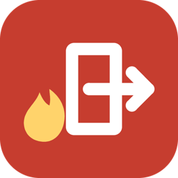
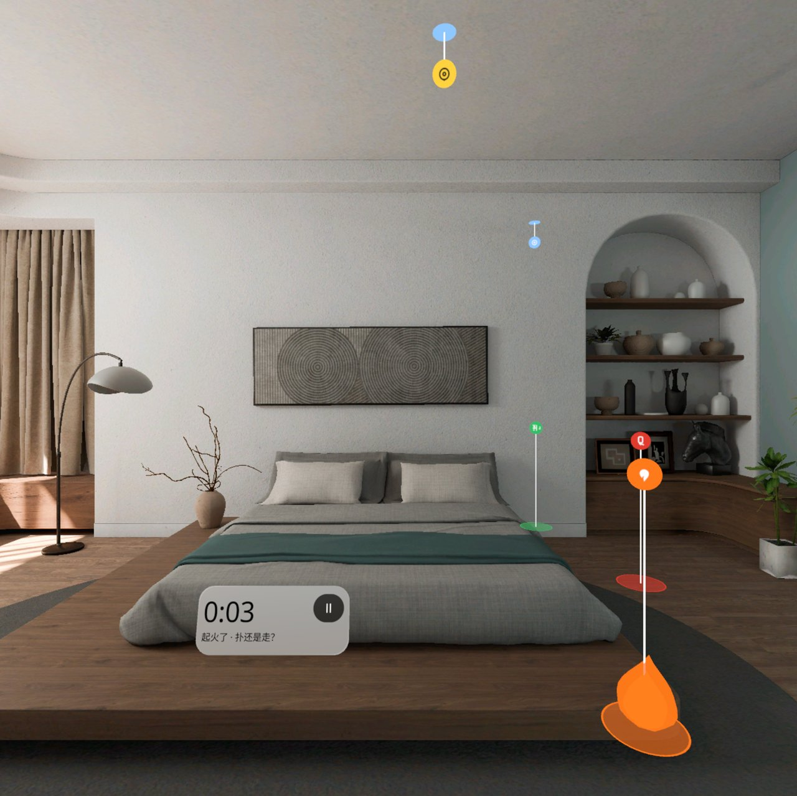
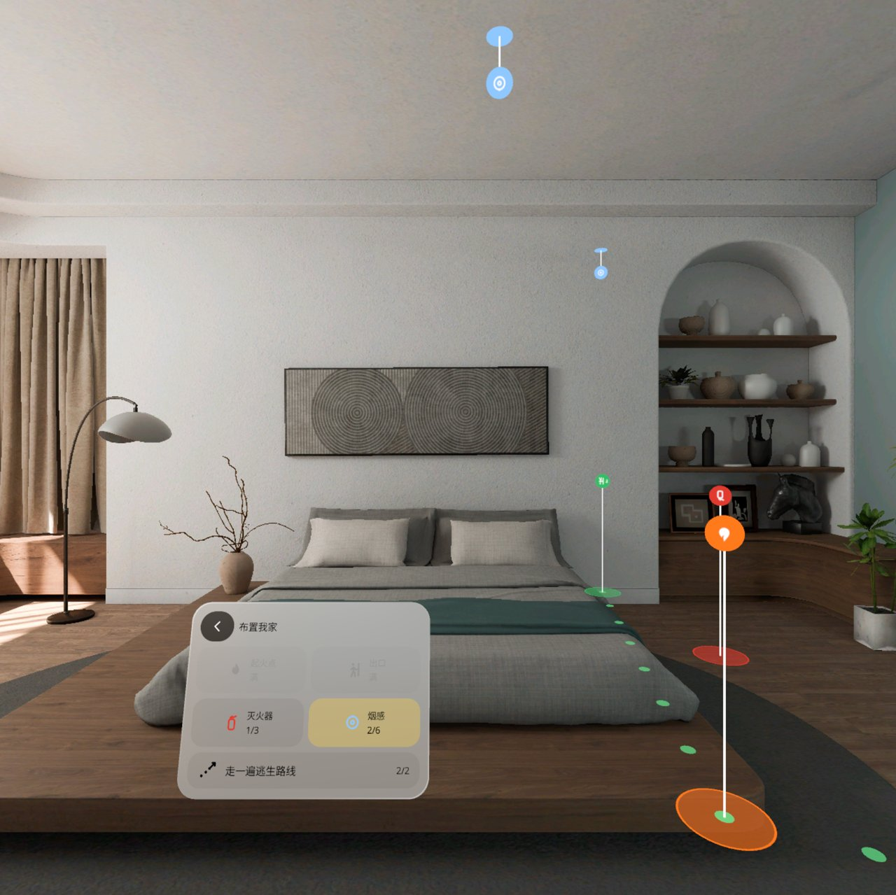
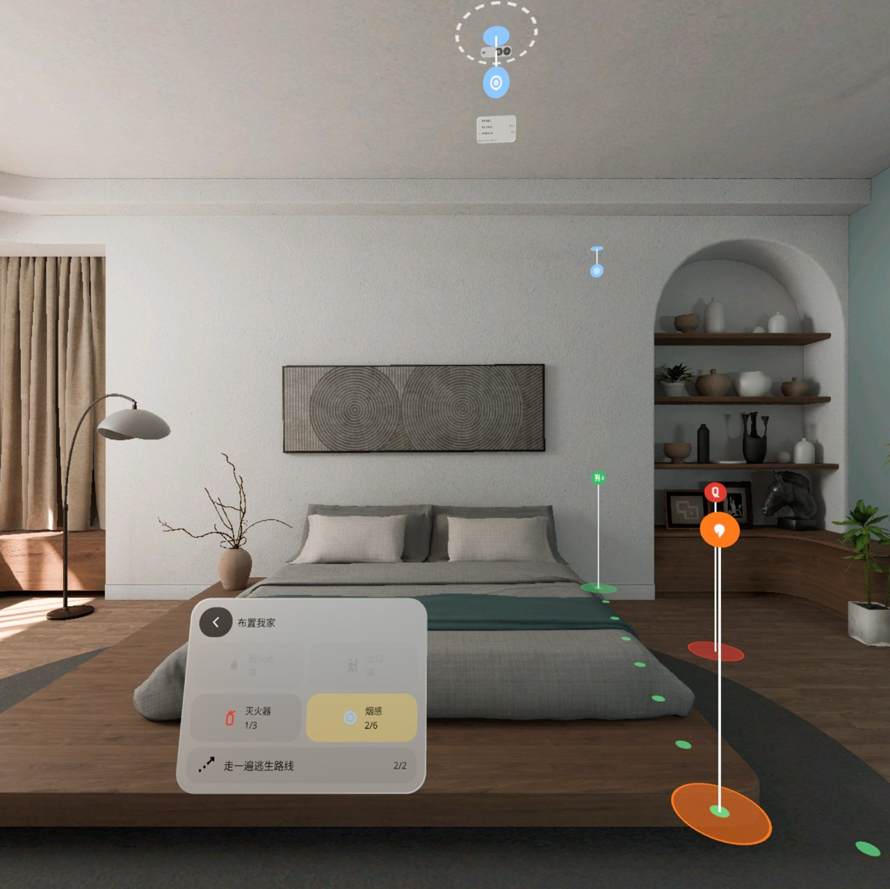
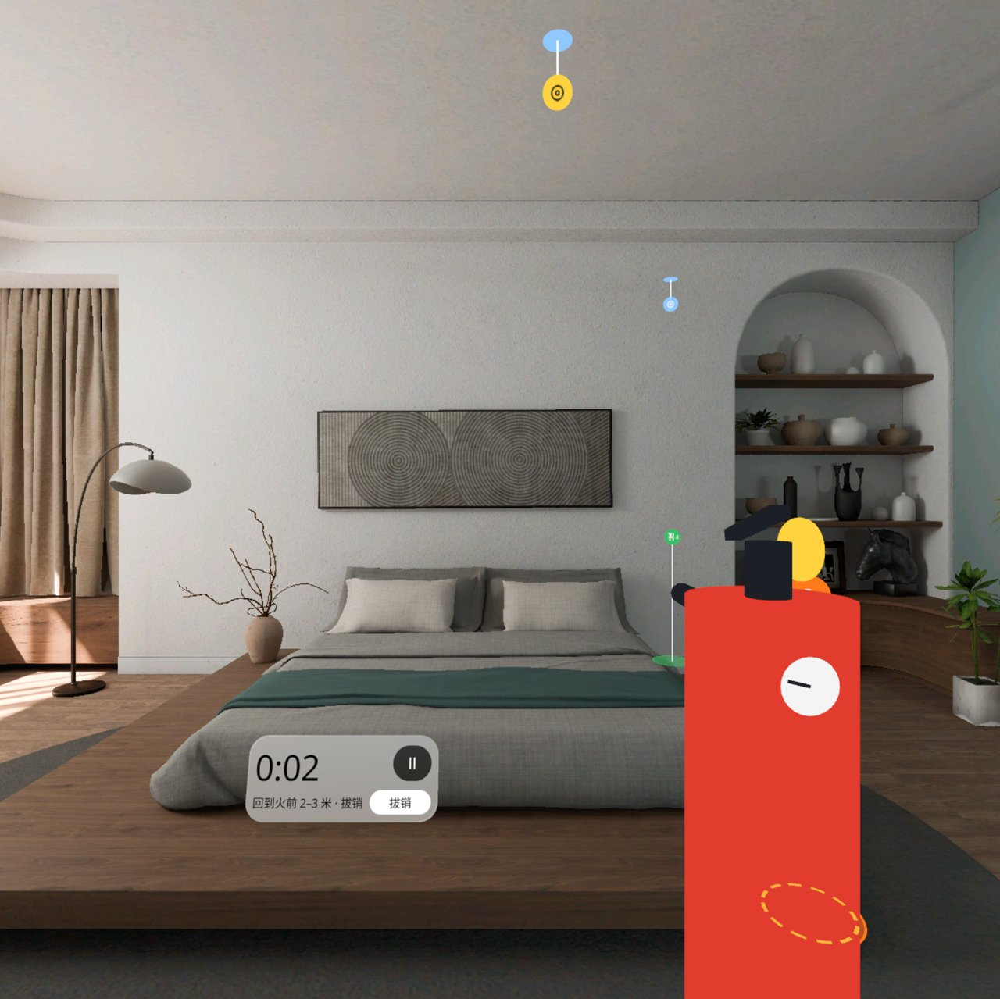
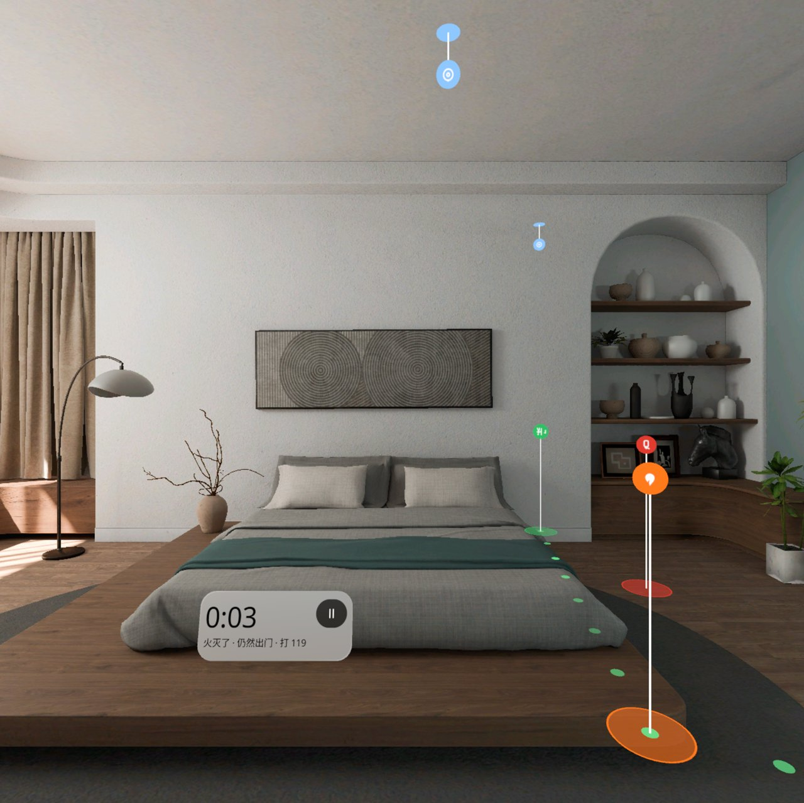
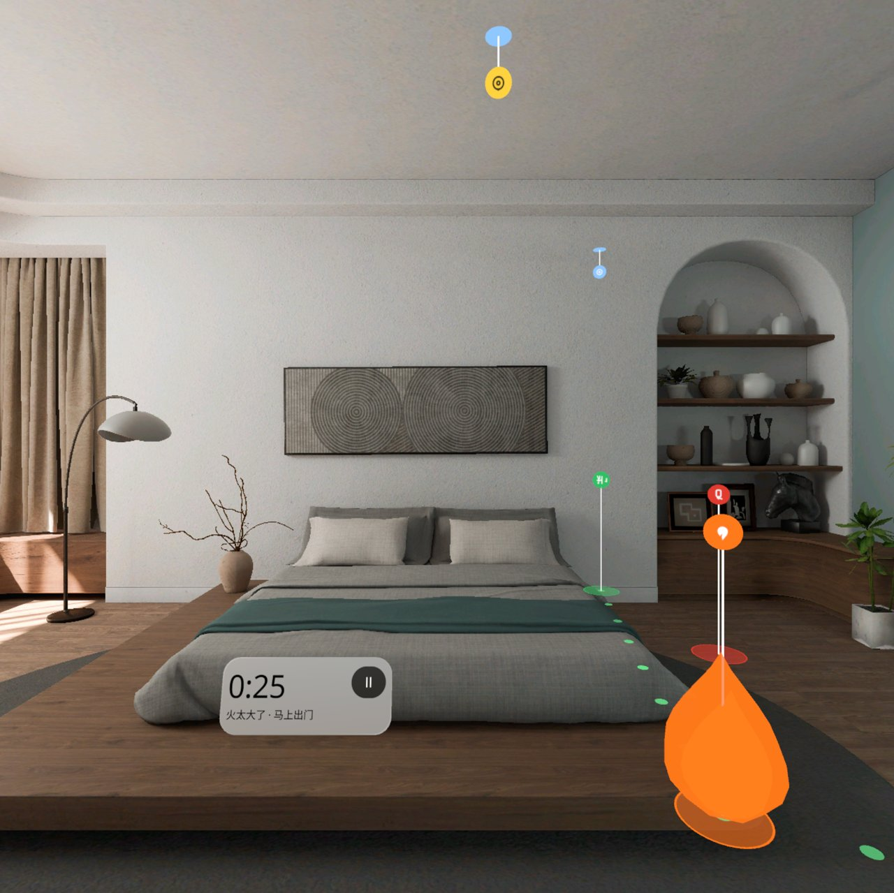
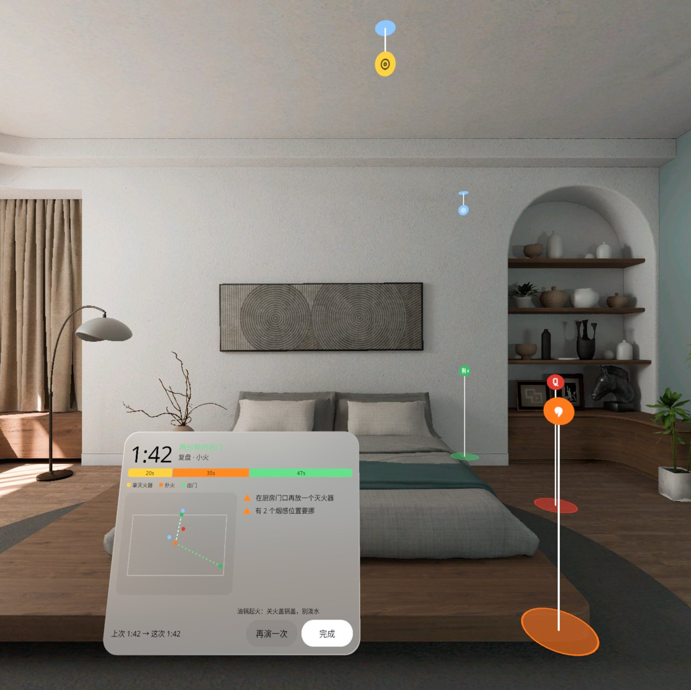
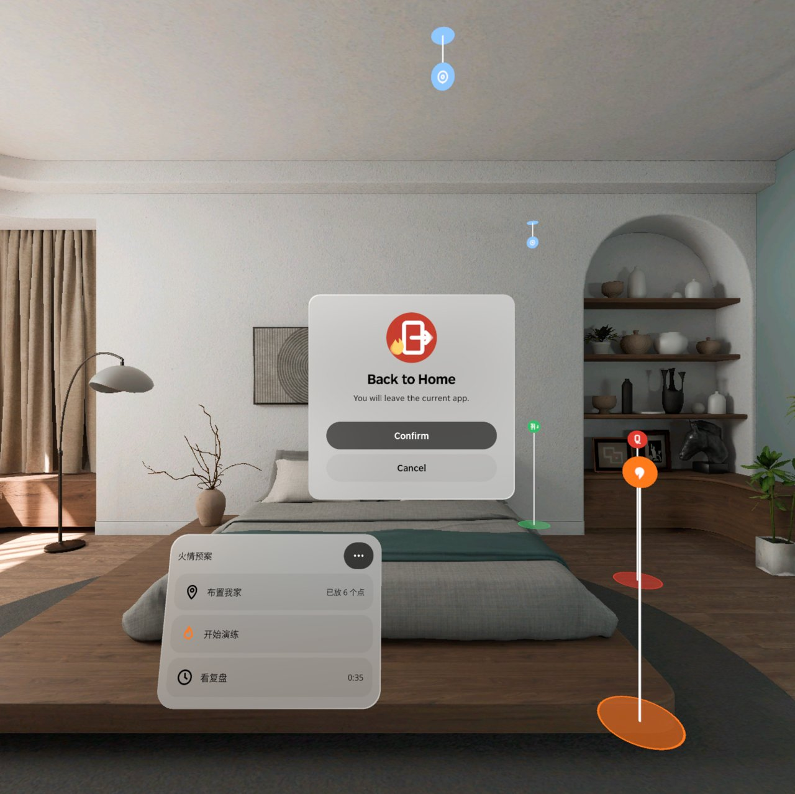

<p align="center"></p>

# Fire Plan | 家庭火情预案

**在你家标出灶台、灭火器、出口和烟感，自己走一遍逃生路线；灶台起一团小火，扑得灭就拔销瞄根压把扫，火大了沿绿点出门——看你家两分钟够不够。**

**Mark the stove, extinguishers, exits and smoke alarms in your own home and walk your escape route once. Then a small fire starts by the stove: put it out with Pull-Aim-Squeeze-Sweep, or, if it grows, follow your own green dots to the door — and see whether two minutes is enough.**

PICO OS 6 · PICO Spatial SDK 6.1.9 · Kotlin / SpatialUI · package `io.embodit.fireplan` · v0.1.0 (pre-release / 预发布)

> **模拟器 QA 通过，真机未验证（Simulator-QA passed; not yet verified on a real headset）。**



> 截图和演示视频来自原生模拟器（PICO Emulator 6.1），由调试广播驱动跳转到各设计状态；**非真实手势录像**。
> Screenshots and the demo video were taken on the native PICO emulator, driven by debug broadcasts that jump to each design state; **not a recording of real hand gestures.**

---

## 中文

### 这是什么

家里的火情预案：起火了先干什么、灭火器在哪、从哪扇门出去、要多久。第一次花 10 分钟，在真实的灶台、门口、天花板上放 4 种标点（起火点、灭火器 ≤ 3、出口 ≤ 2、烟感 ≤ 6），并按平时速度走一遍逃生路线；放下烟感当场检查离墙、离灶台够不够远。之后每次演练 2–3 分钟：倒数后灶台旁起一团小火，警报从你标的烟感位置响起，你决定扑还是走——走到灭火器旁、回到离火 2–3 米拔销、瞄火根、按住喷、左右扫；火长大了就沿你自己走出来的绿点出门。复盘告诉你总用时对不对得上两分钟线、每段花了多久、灭火器够不够近、烟感要不要挪。

安全：倒数页提醒「快走别跑 · 到门口就停，不用开门」，透视全程开着，撤离时灭火器道具自动隐藏。全部本机保存，不联网、不需要账号。

### 安装与启动

```bash
adb install -r FirePlan-v0.1.0.apk
pico-cli app launch io.embodit.fireplan
```

APK 在 [Releases](https://github.com/kejing-dev/FirePlan/releases) 页面下载（仓库不含 APK）。需要 PICO OS 6 头显或 PICO Emulator 6.1；用到平面识别和空间锚点。APK 约 45 MB（内含完整中文字体）。

### 容器与骨架

- **容器**：只有 Full Space · `STAGE_MIXED`（透视），没有 Shared Space 版本。标点要落在你家真实的灶台和门口、路线要你真的走一遍，依赖平面识别（FLOOR / CEILING / DOOR / TABLE）、头部位姿和世界锚点，这些只在 Full Space 可用。
- **骨架 D**（同空间尺 Spatial Ruler）：平面识别 + 平面薄盒碰撞、每个标点一个世界锚点、懒跟随主面板、自建对话框 / 提示条面板、面板池、每帧朝向 System、空间音频警报。所有规则（落点、到达判定、PASS 状态机、复盘结论）在纯 Kotlin domain 层。
- **状态**：设计包 26 个状态（S00–S23、S15+M1、M2），全部可由调试广播直接跳转并截图，结构见 [AGENTS.md](AGENTS.md)。

### 截图

| | |
|---|---|
|  |  |
| 标点盘 — 4 种标点格子，地上是你录下的绿点路线 | 烟感检查 — 三条检查，离灶台不足 3 m 标橙 |
|  |  |
| 拿到灭火器 — 右下道具，「回到火前 2–3 米 · 拔销」 | 火灭了 — 「仍然出门 · 打 119」，绿点亮到门口 |
|  |  |
| 火太大 — 25 秒没扑灭火长大，「马上出门」 | 复盘 — 1:42 两分钟内出门，分段用时 + 俯视图 + 结论 |

启动器图标：



### 已知问题（QA 第 1 轮，不影响使用）

- 倒数阶段最近的烟感牌就开始闪黄（设计是起火后才闪、才响）。
- 瞄准火根时火根圈没有从虚线变成实线（调试注入下看到的；真机用真实指向再核一次）。
- 火根圈会透过近处的灭火器道具显示出来；同一视角下道具会挡住火焰（模拟器视野窄，真机转头即分开）。
- 灭火后用调试命令强制跳到「火太大」时火焰不重新出现（真实流程没有这条路径）。
- 复盘面板、更多菜单、暂停菜单在模拟器上第一次出现要 8–12 秒（模拟器空闲只有 2–4 帧/秒）。
- 演示视频帧率不稳（约 16 帧/秒），是模拟器限制，不是应用问题。

还没在头显上验过：警报方向感、手柄 / 手势扫射手感、真人走路的路线和锚点漂移、真实家里天花板识别、权限弹窗，以及「人在出口旁先离开门口」那一步。

---

## English

### What it is

A fire plan for your own home: what to do first, where the extinguisher is, which door to leave by, and how long it takes. The first time (about 10 minutes) you place four kinds of markers on your real stove, doors and ceiling — fire spot, extinguishers (≤ 3), exits (≤ 2), smoke alarms (≤ 6) — and walk your escape route at normal pace; each smoke alarm gets an on-the-spot distance check (from walls, from the stove). After that each drill takes 2–3 minutes: after a countdown a small stylised fire starts by the stove, the alarm sounds from the detector you marked, and you decide — fetch the extinguisher, step back to 2–3 m, Pull, Aim at the base, Squeeze and Sweep; or, if the fire grows, follow the green dots you walked yourself to the door. The review shows your total time against the two-minute line, each segment, whether the extinguisher is close enough and which alarms should move.

Safety: the countdown says "walk, don't run — stop at the door, don't open it", passthrough stays on throughout, and the extinguisher prop hides while you evacuate. Everything is stored on the device; no network, no account.

### Install and launch

```bash
adb install -r FirePlan-v0.1.0.apk
pico-cli app launch io.embodit.fireplan
```

Download the APK from the [Releases](https://github.com/kejing-dev/FirePlan/releases) page (the repository itself does not ship an APK). Needs a PICO OS 6 headset or PICO Emulator 6.1; uses plane detection and spatial anchors. The APK is about 45 MB because it bundles the full Chinese font.

### Container and skeleton

- **Container**: Full Space only, `STAGE_MIXED` (passthrough); no Shared Space version. Markers must sit on your real stove and doors and you must actually walk the route, which needs plane detection (FLOOR / CEILING / DOOR / TABLE), head pose and world anchors — all Full Space only.
- **Skeleton D** (same as Spatial Ruler): plane detection with thin-box plane colliders, one world anchor per marker, lazy-follow main panel, home-made dialog / hint panels, panel pool, per-frame billboarding system, spatial-audio alarm. All rules (placement, arrival, the PASS state machine, review findings) live in a pure Kotlin domain layer.
- **States**: 26 designed states (S00–S23, S15+M1, M2), each reachable by a debug broadcast and captured; see [AGENTS.md](AGENTS.md).

### Screenshots

See the table above: marker tray with the green route, smoke-alarm check card, extinguisher in hand, fire out, fire too big — evacuate, and the review panel.

### Known issues (QA round 1, none blocking)

- The nearest smoke-alarm plate already flashes yellow during the countdown (design: only after the fire starts).
- When aiming at the base, the base ring stays dashed instead of turning solid (seen with injected aiming; to be re-checked with real pointing on a headset).
- The base ring shows through the nearby extinguisher prop, and from the same viewpoint the prop hides the flame (narrow emulator field of view; separates as soon as you turn your head on a headset).
- Forcing "fire too big" by debug command after the fire is out does not bring the flame back (not a path the real flow can take).
- The review panel, More menu and Pause menu take 8–12 s to appear the first time on the emulator (the idle emulator runs at 2–4 fps).
- The demo video has an uneven frame rate (about 16 fps) — an emulator limit, not the app.

Not yet verified on a headset: alarm direction, controller / hand sweep feel, real walking routes and anchor drift, ceiling detection in a real home, permission prompts, and the "step away from the exit first" check.

---

## License

Source code © 2026 Embodit. All rights reserved (private repository). Bundled fonts Noto Sans / Noto Sans SC are under the SIL Open Font License, see `third_party/`.
