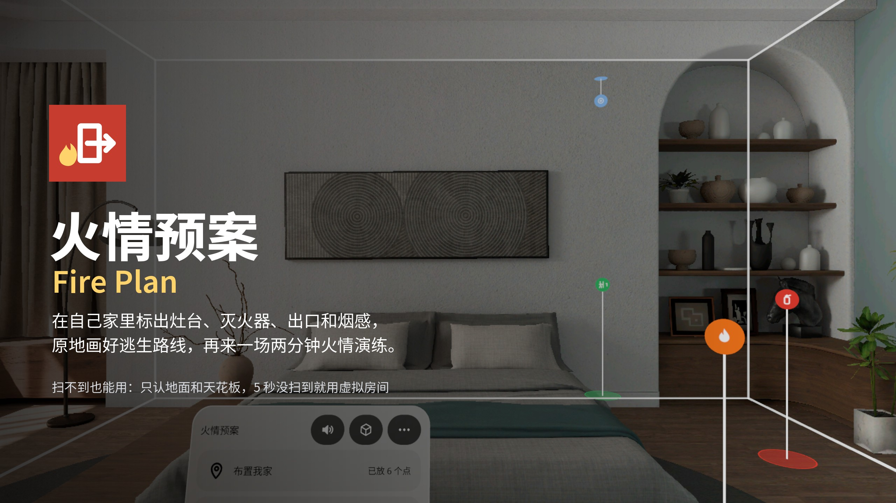
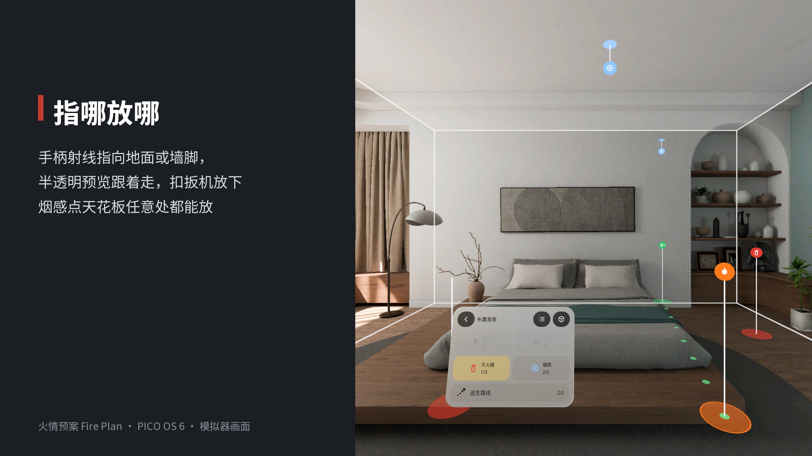
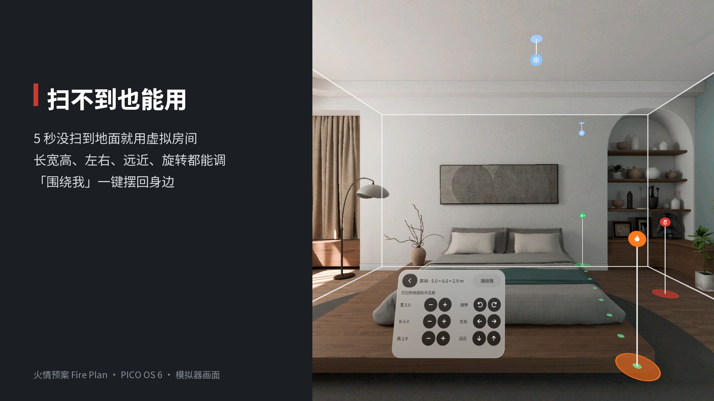
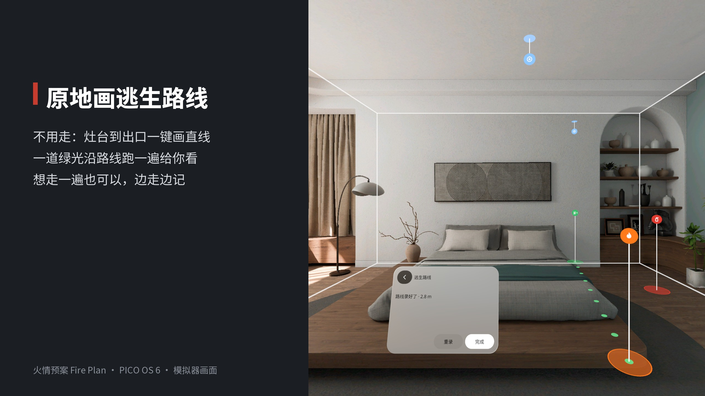
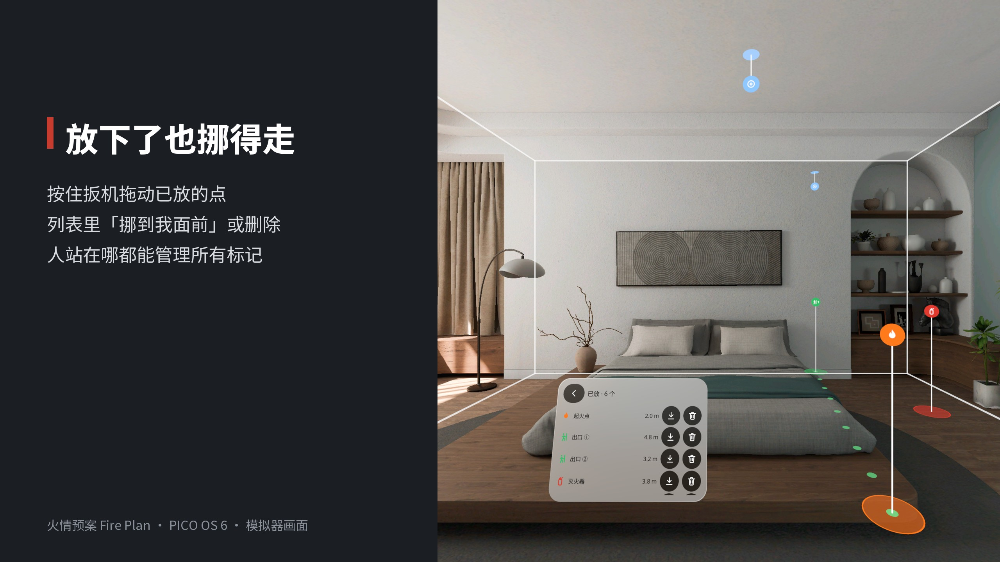
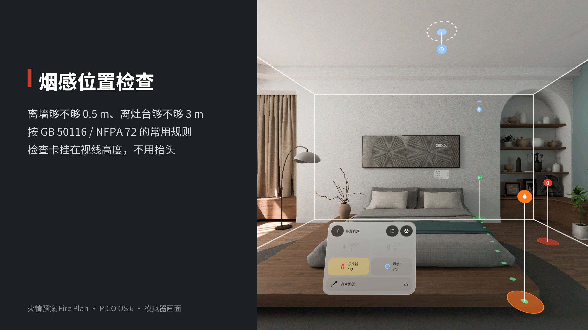
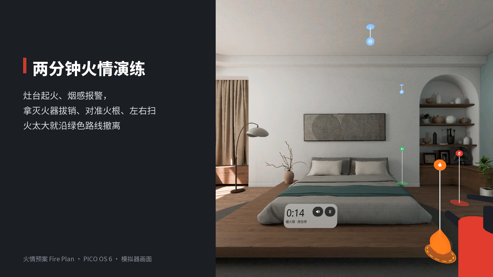
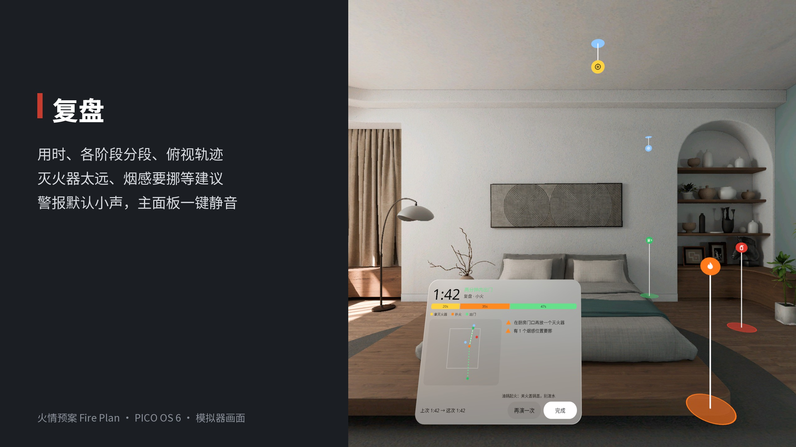

<p align="center"></p>

# Fire Plan | 家庭火情预案

**在自己家里标出灶台、灭火器、出口和烟感，原地画好逃生路线，再来一场两分钟火情演练：扑得灭就拔销、瞄根、压把、扫，火大了沿绿色路线出门。**

**Mark the stove, extinguishers, exits and smoke alarms in your own home, draw your escape route without walking it, then run a two-minute fire drill: put the fire out with Pull-Aim-Squeeze-Sweep, or, if it grows, follow your green route out.**

PICO OS 6 · PICO Spatial SDK 6.1.9 · Kotlin / SpatialUI · package `io.embodit.fireplan` · **v0.1.2**



> 截图来自原生模拟器（PICO Emulator 6.1，Graphics High Definition），由调试广播驱动；**非真实手势录像**。
> Screenshots were taken on the native PICO emulator (Graphics High Definition), driven by debug broadcasts; **not a recording of real hand gestures.**

---

## 中文

### 这是什么

家里的火情预案：起火了先做什么、灭火器在哪、从哪扇门出去、要多久。

- **布置**：放 4 种标记，分别是起火点、灭火器（最多 3 个）、出口（最多 2 个）、烟感（最多 6 个）。用手柄射线指向地面、墙脚或天花板，会有一个半透明的预览跟着走，扣扳机（或捏合）就放下。放下的烟感当场检查：离墙够不够 0.5 m，离灶台够不够 3 m。
- **不卡扫描**：只认地面和天花板。5 秒没扫到地面就用一个虚拟房间（默认 5×6×2.7 m），房间卡里可以调长宽高、左右平移、推远拉近、旋转，「围绕我」一键摆回身边。
- **少走动**：路线卡里「原地画路线」一键画出灶台到出口的直线路线，画好后会有一道绿光沿路线跑一遍。想按平时速度走一遍也可以。
- **放了也挪得走**：按住扳机就能拖动已放的点。托盘里的列表能把任何一个点「挪到我面前」或删掉。
- **演练**：倒数之后灶台旁起一团小火，警报从你标的烟感位置响起。扑火就走到灭火器旁，退到离火 2–3 m，拔销、瞄火根、按住、左右扫；火长大了就沿绿色路线出门。
- **复盘**：总用时对不对得上两分钟线、每段花了多久、灭火器够不够近、哪个烟感要挪。
- **声音**：警报默认小声、柔和；主面板和演练卡上都有静音键。

安全提示：倒数页会提醒「快走别跑 · 到门口就停，不用开门」，透视全程开着，撤离时灭火器道具自动隐藏。全部数据保存在本机，不联网，不需要账号。

### 安装与启动

```bash
adb install -r FirePlan-v0.1.2.apk
pico-cli app launch io.embodit.fireplan
```

APK 在 [Releases](https://github.com/kejing-dev/FirePlan/releases) 页面下载（仓库本身不含 APK）。需要 PICO OS 6 头显或 PICO Emulator 6.1，用到平面识别和空间锚点。APK 约 45 MB，因为内含完整中文字体。

### 截图

| | |
|---|---|
|  |  |
|  |  |
|  |  |
|  |  |

### 版本

- **v0.1.2**：放置后标记牌上的图标上下颠倒，已修。原因是引擎取贴图时 v=0 对应位图最底行。牌子现在只绕竖直轴转向你，不俯仰、不镜像。
- **v0.1.1**（按办公室真机试用反馈）：只认地面和天花板，扫不到就用虚拟房间；烟感和出口随处可放；原地画路线；手柄射线预览与拖动；已放标记列表；静音键，警报改得更小声、更柔和；UI 遮挡全量排查。
- **v0.1.0**：首版。

真机已装 v0.1.2，还没有真人戴头显完整试过一遍演练（警报方向感、扫射手感、真实走路时的锚点漂移）。

---

## English

### What it is

A fire plan for your own home: what to do first, where the extinguisher is, which door to leave by, and how long it takes.

- **Set up**: four kinds of markers — fire spot, extinguishers (≤ 3), exits (≤ 2), smoke alarms (≤ 6). Point the controller ray at the floor, the foot of a wall or the ceiling; a see-through preview follows the ray, and the trigger (or a pinch) puts the marker down. Each smoke alarm is checked on the spot: at least 0.5 m from walls and 3 m from the stove.
- **Never stuck scanning**: only the floor and the ceiling are detected. With no floor after 5 s a virtual room is used (5 × 6 × 2.7 m by default); the room card adjusts its size, slides, pushes, turns it, and puts it back around you.
- **Little walking**: "Draw it from here" makes a straight route from the fire spot to the exit, and a green light runs along any saved route. You can still walk it at normal pace.
- **Movable**: hold the trigger on a placed marker to drag it. The tray's list moves any marker in front of you or deletes it.
- **Drill**: after a countdown a small fire starts by the stove and the alarm sounds from the detector you marked. Fetch the extinguisher, step back to 2–3 m, Pull, Aim at the base, Squeeze, Sweep — or, if the fire grows, follow your green route out.
- **Review**: total time against the two-minute line, each segment, whether the extinguisher is close enough, which alarms should move.
- **Sound**: the alarm is quiet and soft by default; a mute key sits on the main panel and on the drill card.

Safety: the countdown says "walk, don't run — stop at the door, don't open it", passthrough stays on throughout, and the extinguisher prop hides while you evacuate. Everything is stored on the device; no network, no account.

### Install and launch

```bash
adb install -r FirePlan-v0.1.2.apk
pico-cli app launch io.embodit.fireplan
```

Download the APK from the [Releases](https://github.com/kejing-dev/FirePlan/releases) page. Needs a PICO OS 6 headset or PICO Emulator 6.1; uses plane detection and spatial anchors. The APK is about 45 MB because it bundles the full Chinese font.

### Versions

- **v0.1.2**: the icon plates on placed markers were upside down (the engine samples texture v = 0 from the bitmap's bottom row). Plates now turn about the vertical only, never pitched or mirrored.
- **v0.1.1** (office headset feedback): floor and ceiling only, a virtual room when nothing is detected; alarms and exits can be placed anywhere; route drawn without walking; controller-ray preview and drag; marker list; mute key, quieter and softer alarm; full UI occlusion audit.
- **v0.1.0**: first release.

v0.1.2 is installed on a headset; a full drill with a person wearing it (alarm direction, sweep feel, anchor drift while walking) is not verified yet.

---

## License

Source code © 2026 Embodit. All rights reserved (private repository). Bundled fonts Noto Sans / Noto Sans SC are under the SIL Open Font License, see `third_party/`.
